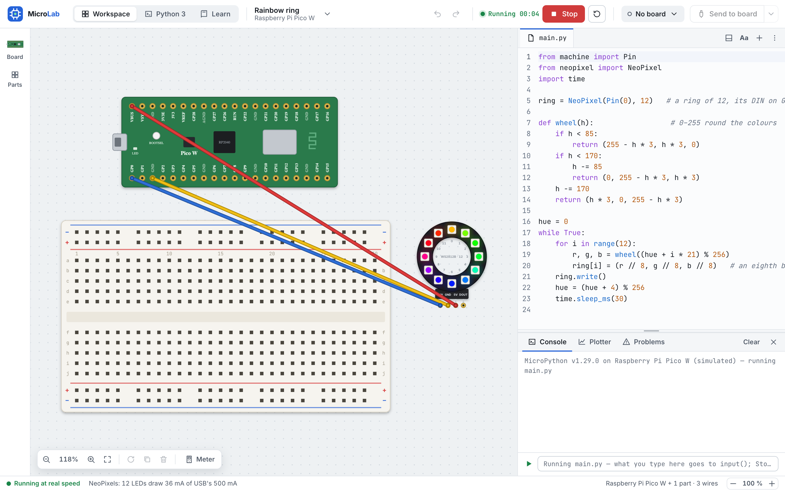

# MicroLab

Build breadboard circuits, write MicroPython and see them work — on a BBC micro:bit V2, a Raspberry Pi Pico W or
an ESP32 DevKit V1, in the simulator or on the real board — and write Python 3 programs, as in IDLE. A desktop app
for students, by CodingSpaceKH.



- **Build** — the board, breadboards and 57 parts (LEDs, buttons, sensors, motors, displays, NeoPixels, modules),
  wired by dragging from pin to hole; a multimeter; a wiring check before each run.
- **Program** — the real MicroPython (1.29, its own WebAssembly build) runs your code; the parts answer as the
  circuit says: an LED's current, a sensor's reading, a pin damaged by a short. Errors are explained in plain words,
  with *Go to line*. A console and a REPL, a plotter, 56 examples.
- **On the real board** — plugged in, MicroLab names it within 2 s, with no port to choose: **Send to board**,
  its console, its files, installing MicroPython on it.
- **Python 3** — projects are folders; real Python 3.13 runs them, with `input()`, turtle and tkinter, help while
  typing (Jedi), libraries from PyPI, and its shell after the program.

Everything stays on the computer: no account, no tracking, no internet needed (see [Privacy](#privacy)).

## Install

Download from [**the latest release**](https://github.com/codingspacekh/microlab-releases/releases/latest):

- `MicroLab-Setup-<version>.exe` — **Windows 10 (22H2) and 11**, 64-bit. Installed for the student alone (no
  administrator password); the folder can be changed.
- `MicroLab-<version>-mac-arm64.dmg` (Apple chip) or `MicroLab-<version>-mac-x64.dmg` (Intel) — **macOS 13 or later**.

Each carries its own Python 3.13, so nothing else needs installing. 4 GB of memory is enough (MicroLab uses about
400 MB running a 40-part circuit).

The installers aren't signed with paid certificates, so the first time:

- **Windows** says *Windows protected your PC*: **More info ▸ Run anyway**.
- **A Mac** says it can't be verified: **Done**, then **System Settings ▸ Privacy & Security ▸ Open Anyway**.

A real ESP32 may need its USB driver on Windows (CP210x or CH340); MicroLab's connection helper says which.

## Use it

The Start page makes a project or opens one; its recent projects are below.

- **A board project** is one `.mlab` file — the circuit and its files (`main.py`, `lib/`), as on the board — made in
  `Documents/MicroLab` unless you choose elsewhere. **Run** (F5) runs the open file in the simulator; **Stop**
  (Shift+F5). **Send to board** copies the files to the real board. **Project menu ▸ Close project** goes back to
  the Start page.
- **A Python project** is a folder you choose; its files are beside the editor. **Run** (F5) runs the file shown;
  its shell comes after it. **Libraries** installs from PyPI or a `.whl` file, into MicroLab's own folder.
- **Aa** sets the code's size, font and theme (light, dark, High contrast); the status bar sets the app's size.
- MicroLab keeps a copy of unsaved changes: after a crash, the Start page offers them back.

## Updates

An installed MicroLab looks for a new version when it opens and every 6 hours. When one is out it says so —
**Download**, then **Restart and update** (or it goes in when MicroLab is next closed). Unsaved work is asked about
first. *Help ▸ Check for Updates…* (MicroLab ▸ on a Mac) looks at once.

## Privacy

No account and no tracking. Projects are the student's own files; MicroLab's settings and its copy of unsaved
changes are in its folder (`%APPDATA%\MicroLab` on Windows, `~/Library/Application Support/MicroLab` on a Mac).

MicroLab works fully offline — a whole lesson, board and Python 3, is tested with every request that would leave the
computer refused, and none is made. It goes online only when asked: an installed MicroLab looking for updates (the
releases page above), and **Libraries** installing a Python library (PyPI). A student's own Python program can reach
the internet if it is written to. **About ▸ codingspacekh.dev** opens the browser.

## For development

You need [Node.js](https://nodejs.org) 24.

```bash
npm ci
npm run fetch:python   # Python 3.13 and Jedi for this computer, each checked by its SHA-256, into vendor/
npm run dev            # the app with live reload
```

```bash
npm run check          # the gate: lint, type-check, tests with coverage, the speed budgets, build
npm run e2e            # the end-to-end tests against the built app — its window never shown, never focused
npm run perf           # the solver's and the simulator's speed budgets
npx vitest --project unit   # one layer while working (also: python, python3, integration, acceptance, component)
```

- `npm run examples` — every example as a `.mlab`, in `out/examples/`, for trying parts by hand.
- `npm run old-projects` — a project saved by each released version, made by that version's own code
  (`tests/fixtures/projects/saved-by/`): every later MicroLab must open them.
- `npm run licences` — `THIRD_PARTY_LICENSES`, everything MicroLab ships that CodingSpaceKH didn't write; every
  installer build makes it and stops at a missing or copyleft licence.
- `npm run dist` — the installer for this computer. Releases: [docs/RELEASING.md](docs/RELEASING.md); a test
  installer for Windows without a release: `git push origin dev:installer`.

GitHub Actions runs `npm run check` and every end-to-end test for each push to `main` and `dev`, on an Apple-chip
Mac, an Intel Mac and Windows (`[e2e all]` in a commit message runs all of them to the end, past 5 failures).

The plan and its records:

- [System analysis & requirements](docs/01-analysis-and-requirements.md)
- [Architecture](docs/02-architecture.md)
- [Milestones & TDD workflow](docs/MILESTONES.md) — the build plan, each milestone's gate, progress
- [Gate records](docs/acceptance/) — what each milestone delivered, its tests, what was found
- [UI prototype](design/screens/index.html) — `python3 -m http.server 8000 --directory design/screens`

## Licence

© 2026 CodingSpaceKH. All rights reserved. The code is public to read; it carries no licence to reuse it.

MicroLab is built with parts made by others, each under its own licence — Electron, MicroPython, Python and its
libraries, Jedi, the boards' firmware, the fonts and more — listed in **About ▸ Licences**
(`THIRD_PARTY_LICENSES`, made by `npm run licences` with every build). micro:bit, Raspberry Pi and ESP32 are
their owners' trademarks; MicroLab is not made or endorsed by them.

To contribute, report a problem or share an idea: [codingspacekh.dev](https://codingspacekh.dev).
